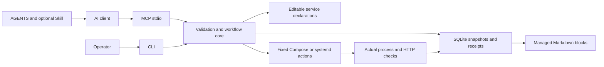

# Architecture and ownership

Server owners and authorized agents use the same core through CLI or MCP. The first release targets single-host self-managed Linux/Compose workloads. Existing project locations remain valid; the tool does not install an LLM, relocate applications or create a privileged daemon.

## Three kinds of evidence

Declarations state reviewed intent: identity, paths, ports, dependencies and maintenance references. They are stored in each service directory, so project metadata can travel with its source. Registration snapshots the validated declaration and SHA-256 into a transactionally updated local catalog/history.

Observations report what a fresh fixed read-only query returned. Insufficient permissions, unsupported runtimes and timeouts return unknown. A running process does not establish complete application correctness.

Receipts record a particular operation's plan, source hashes, real step outcomes, timestamps and check scope. A successful receipt describes those checks at that time; it is not a permanent health assertion. Its latest summary appears in service details.

## Persistence and interruption

`state.sqlite3` contains current snapshots, revision history, and managed operation receipts. SQLite schema version is explicit. Readers open read-only connections; writes use an immediate transaction and expected-revision checks. Unknown/incompatible databases are rejected instead of repurposed.

Managed operations claim a service and commit their plan before executing any external command. Registering another revision or starting a second operation on that service is refused while it is running. Every finished step is saved. Abrupt termination leaves an incomplete receipt; a later recovery checks owner liveness and marks it interrupted without replay.

Database transactions cannot roll back Docker, systemd or external application effects. After timeout/interruption, inspect the receipt and live target before making a new plan. Recovery is reconciliation, not rollback. Database initialization and volume deletion are outside this product's managed action set.

Documentation is derived display. A committed operation remains committed if Markdown refresh fails; the receipt records a documentation failure and doctor reports it. Handwritten content outside the managed block remains intact. Metadata source drift is reported rather than silently imported.

## Boundaries

Configured roots are resolved with symlinks before accepting paths. Registered readmes must stay within their service home. MCP reads only workspace entry documents and registered public Markdown, at most 64 KiB. Configuration/data/credential references are paths and are not read by document tools.

Descriptor `commands` are descriptive text, never an execution interface. Managed commands use fixed argument lists and the exact registered Compose files/project/service or systemd units. Compose preflight uses `config --quiet`; interpolated configuration and raw command output are not copied into receipts. HTTP checks do not follow redirects or retain response bodies.

The default MCP mode exposes read operations. Write mode is explicit and adds registration/apply, using the same validators and receipts as CLI. MCP annotations describe intent; server code enforces the actual boundaries.

Changes made by an unrestricted shell or another deployment system cannot be fully attributed by this tool. Drift checks provide evidence of difference, not complete auditing. Existing project rules and current user instructions are preserved.
